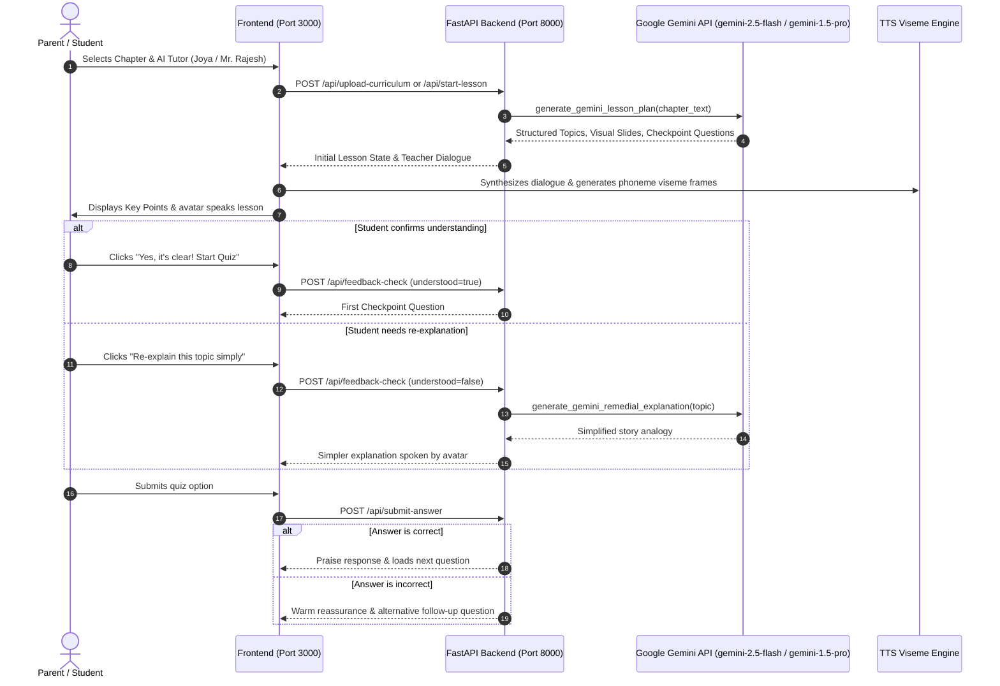
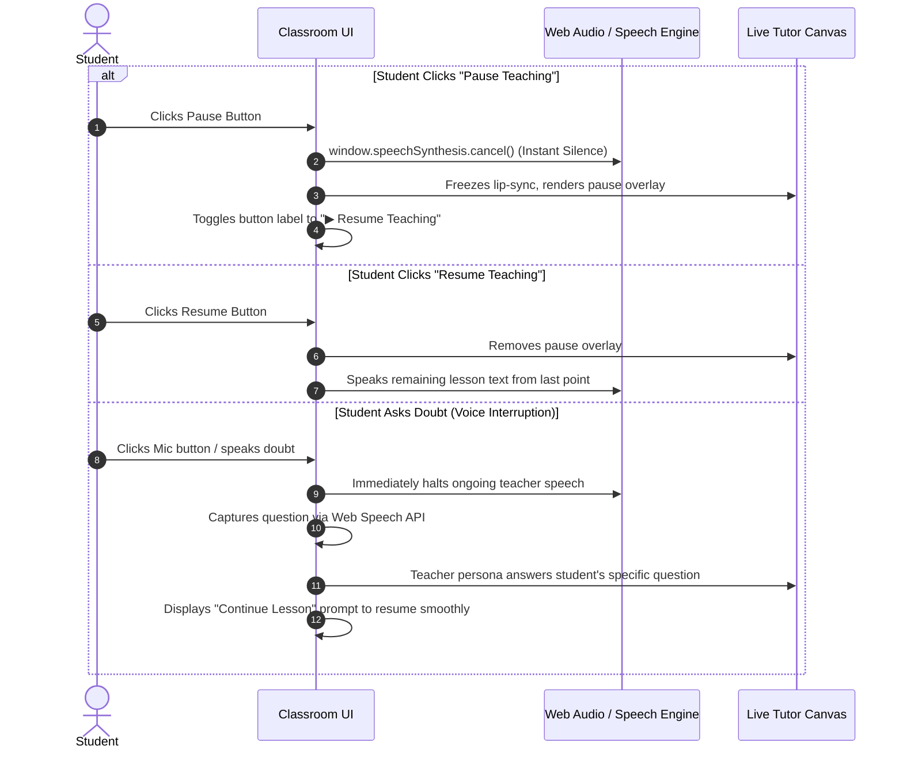

# MyTutor: Multi-Platform AI Teacher & Socratic Learning Ecosystem 🎓
### Personalized AI Avatars, Real-Time Bidirectional Speech & Interactive Socratic Pedagogy

**MyTutor** is a next-generation AI-powered educational platform engineered for **Web, iOS, Android, Android TV, and Set-Top Boxes (STBs)**. It delivers an engaging, private tutoring experience that ingests full textbook chapters, generates structured multi-unit lesson plans, and teaches students through photorealistic AI teacher avatars (**Joya** and **Mr. Rajesh**) with synchronized lip-sync, real-time voice doubt clarification, spatial TV remote navigation, and adaptive remedial loops.

---

## 📑 Table of Contents
1. [Core Features](#-core-features)
2. [End-to-End User Experience & Screens](#-end-to-end-user-experience--screens)
   * [1. Parent Setup Portal](#1-parent-setup-portal)
   * [2. Live Avatar Socratic Classroom](#2-live-avatar-socratic-classroom)
   * [3. Parent Performance Report Digest](#3-parent-performance-report-digest)
3. [Architecture & Workflow](#-architecture--workflow)
   * [Lesson Generation & Socratic Flow](#a-lesson-generation--socratic-teaching-flow)
   * [Live Speech & Pause/Resume Control](#b-speech-control--avatar-interruption-flow)
4. [Repository Directory Structure](#-repository-directory-structure)
5. [Quick Setup & Run Guide](#-quick-setup--run-guide)
   * [Prerequisites](#prerequisites)
   * [Windows (PowerShell)](#windows-powershell-launch)
   * [macOS / Linux (Bash)](#macos--linux-bash-launch)
6. [Environment Configuration](#-environment-configuration)
7. [Service & Ports Dashboard](#-service--ports-dashboard)
8. [Git & Branch Guidelines](#-git--branch-guidelines)

---

## ✨ Core Features

* 👩‍🏫 **Curated AI Teacher Personas**:
  * **Joya** (*Female Teacher*): Patient, warm, supportive, and encouraging tone.
  * **Mr. Rajesh** (*Male Teacher*): Concept-driven, analytical mentor with clear real-world examples.
* 📚 **Deep Textbook & Document Ingestion**:
  * Upload custom textbook chapters (`.pdf` or `.txt`) with zero truncation.
  * Built-in **Saved Chapters Library** with pre-loaded curriculum units and instant unit reloading.
* ⏸️ **Instant Pause & Resume Teaching**:
  * Dedicated classroom control button to pause the teacher at any moment.
  * Instantly halts active synthesized voice speech, suspends mouth lip-sync, and smoothly dims the avatar stage with a clean pause indicator until resumed.
* 🎙️ **Context-Aware Voice Doubt Clarification**:
  * Students can speak aloud or type questions at any time (*e.g., "Can you explain this concept again?"*).
  * The teacher pauses the lesson, explains the doubt pedagogically, verifies comprehension, and resumes the lesson exactly where it was left off.
* 🔄 **Adaptive Remedial Loop**:
  * If a student answers a checkpoint question incorrectly, the teacher does not penalize them.
  * The AI immediately provides a simpler real-world analogy and presents a fresh follow-up checkpoint question until concept mastery is achieved.
* 📺 **Set-Top Box & Android TV Spatial Navigation**:
  * Full D-Pad remote control support (`UP`, `DOWN`, `LEFT`, `RIGHT`, `ENTER/OK`) for selecting quiz options with high-visibility glowing focus rings.
* 📊 **Parent Analytics & Performance Digest**:
  * Comprehension score dial, mastered units breakdown, focus review topics, teacher persona notes, recommended home activities, and full Q&A audit history.

---

## 🖥️ End-to-End User Experience & Screens

The application follows an intuitive, distraction-free 3-stage learning flow:

```
┌─────────────────────────┐       ┌─────────────────────────┐       ┌─────────────────────────┐
│   1. Parent Setup       │  ──>  │   2. Live Classroom     │  ──>  │   3. Parent Report      │
│   - Child Profile       │       │   - AI Avatar (Joya/Raj)│       │   - Comprehension Score │
│   - AI Tutor Select     │       │   - Key Points & Quiz   │       │   - Mastered Concepts   │
│   - Upload / Library    │       │   - Doubt Voice Mic     │       │   - Teacher Notes & Q&A │
└─────────────────────────┘       └─────────────────────────┘       └─────────────────────────┘
```

### 1. Parent Setup Portal
* **Child Profile**: Configure student name, age (4–12), and grade/class level (`Grade 1` through `Grade 6`) with local storage persistence and a quick "Reset Defaults" option.
* **AI Tutor Selection**: Choose between **Joya** (Female Teacher) and **Mr. Rajesh** (Male Teacher) with portrait cards and teacher traits.
* **Learning Material Ingestion**:
  * **Option A**: Upload textbook PDF or text file for automatic syllabus structuring.
  * **Option B**: Select from pre-loaded chapters in the **Saved Chapters Library** (e.g., *Our Families and Communities*, *Plant Nutrition*).
* **Launch Action**: Generates structured topics, checkpoints, and initiates the classroom session with one click.

### 2. Live Avatar Socratic Classroom
* **Classroom Header**: Displays active textbook chapter title, current topic badge, Android STB/TV Remote indicator, star counter, and a clean "← Back" button.
* **Left Stage (AI Teacher Studio)**:
  * Full-frame photorealistic portrait with natural camera framing centered cleanly above the control bar.
  * Millisecond-accurate mouth viseme lip-sync and dynamic audio wave bars.
  * Working **Mic Muted / Active** toggle button.
  * One-click **Pause / Resume Teaching** button with instant audio cutoff and pause overlay.
* **Right Panel (Interactive Learning Deck)**:
  * **Lesson Overview**: Unit label, lesson title, and key conceptual takeaway points with checkmark bullets.
  * **Comprehension Check Bar**: Friendly prompt checking student clarity (*"Is everything clear to you in this topic?"*) with *Start Quiz* and *Re-explain* options.
  * **Checkpoint Quiz**: Multiple-choice cards supporting spatial TV remote D-Pad navigation with dynamic question indexing (*"Quiz Question 1 of 3"*).
  * **Synced Teacher Transcript Box**: Real-time transcript showing exactly what the avatar is explaining, dynamically updated on every question and praise response.
  * **Interactive Doubt Bar**: Voice microphone input or text query field to ask questions at any time.

### 3. Parent Performance Report Digest
* **Score Dial**: Animated circular score dial displaying overall lesson comprehension percentage.
* **Mastered Concepts**: Green tags highlighting topics understood on the first attempt.
* **Focus Topics for Review**: Amber tags denoting topics that required remedial explanations.
* **Teacher Persona Notes**: Pedagogical assessment written in the voice of the selected tutor.
* **Recommended Home Activities**: Practical suggestions for parents to reinforce concepts in daily life.
* **Questions & Answers Audit Log**: Itemized breakdown of all questions asked, the student's selections, and correctness status.
* **Restart Action**: Seamlessly returns to setup for the next lesson.

---

## 🔍 Architecture & Workflow

### A. Lesson Generation & Socratic Teaching Flow



### B. Speech Control & Avatar Interruption Flow



---

## 🏗️ Repository Directory Structure

```
MyTutor/
├── backend/                                # Python FastAPI Backend (Port 8000)
│   ├── app/
│   │   ├── api/
│   │   │   └── routes.py                   # REST endpoints (upload, lessons, doubts, reports)
│   │   ├── models/
│   │   │   └── schemas.py                  # Pydantic data models (LessonPlan, Question, Report)
│   │   ├── services/
│   │   │   ├── pdf_service.py              # PDF/TXT extraction & chapter chunking
│   │   │   ├── llm_service.py              # Gemini lesson planning, remedial analogies & doubts
│   │   │   ├── teacher_service.py          # Socratic state machine, quiz flow & scoring
│   │   │   ├── tts_viseme_service.py       # Viseme mouth animation frame generator
│   │   │   └── gemini_live_avatar_service.py # Gemini Live bidirectional WebSocket gateway
│   │   ├── storage/
│   │   │   └── curriculum_library.json     # Saved curriculum library database
│   │   └── main.py                         # FastAPI application entry point
│   ├── requirements.txt                    # Python dependencies
│   └── .env                                # Gemini API key & configuration
│
├── frontend/                               # React + Vite Frontend (Port 3000)
│   ├── public/
│   │   ├── female_teacher_avatar.jpg       # Joya teacher portrait
│   │   ├── male_teacher_avatar.jpg         # Mr. Rajesh teacher portrait
│   │   └── magic_learning_bg.jpg           # Background artwork
│   ├── src/
│   │   ├── components/
│   │   │   ├── ParentSetup.jsx             # Child configuration, teacher select & upload
│   │   │   ├── StudentClassroom.jsx        # Socratic classroom deck & TV D-Pad navigation
│   │   │   ├── LiveTutorStage.jsx          # Live teacher avatar frame & pause/resume controls
│   │   │   ├── ParentReportView.jsx        # Comprehension score dial & analytics digest
│   │   │   ├── AvatarCanvas.jsx            # Canvas spectrum & lip-sync renderer
│   │   │   └── SlideBoard.jsx              # Topic summary visual cards
│   │   ├── live-avatar/                    # Gemini Live full-duplex video streaming
│   │   │   ├── LiveAvatarApp.tsx           # Live avatar classroom container
│   │   │   ├── components/
│   │   │   │   └── LiveAvatarCanvas.tsx    # MSE video buffer & centered framing
│   │   │   └── hooks/useLiveSession.ts     # Real-time WebSocket connection hook
│   │   ├── styles/
│   │   │   └── index.css                   # Global typography (Inter), responsive design & TV styles
│   │   ├── App.jsx                         # Main application navigation & view router
│   │   ├── main.jsx                        # React root entry
│   │   └── vite.config.js                  # Vite server config (Port 3000) & proxy routing
│   ├── index.html                          # HTML template with Inter typography
│   └── package.json
│
├── Gemini AI avatar module/                # Node.js WebSocket Proxy (Port 5001)
│   └── backend/
│       ├── server.js                       # Express proxy handling GCP Vertex AI token exchange
│       ├── package.json
│       └── .env.local                      # Port 5001 and GCP project configuration
│
├── start.sh                                # All-in-one Unix startup script
├── stop.sh                                 # Clean shutdown script
└── README.md                               # Project documentation
```

---

## 🚀 Quick Setup & Run Guide

### Prerequisites
* **Python**: v3.9+ (verified on 3.9, 3.11, 3.13)
* **Node.js**: v18+ (verified on v20, v22)
* **Gemini API Key**: From [Google AI Studio](https://aistudio.google.com/)

---

### Windows (PowerShell Launch)

Open 3 separate PowerShell terminals:

#### Terminal 1 — Start Python FastAPI Backend (Port 8000)
```powershell
cd backend
python -m pip install -r requirements.txt
python -m uvicorn app.main:app --host 0.0.0.0 --port 8000 --reload
```
* Interactive API Documentation: `http://localhost:8000/docs`

#### Terminal 2 — Start Gemini Live Proxy (Port 5001)
```powershell
cd "Gemini AI avatar module\backend"
npm install
node server.js
```
* Proxy active on: `http://localhost:5001`

#### Terminal 3 — Start React Frontend (Port 3000)
```powershell
cd frontend
npm install
npm run dev -- --host
```
* Open in browser: `http://localhost:3000`

---

### macOS / Linux (Bash Launch)

You can launch all services using the provided startup script:

```bash
# Make executable and launch all services simultaneously
chmod +x start.sh stop.sh
./start.sh
```

Or start manually in individual tabs:

#### Tab 1 — Python Backend
```bash
cd backend
pip install -r requirements.txt
python3 -m uvicorn app.main:app --host 0.0.0.0 --port 8000 --reload
```

#### Tab 2 — Live Avatar Proxy
```bash
cd "Gemini AI avatar module/backend"
npm install
node server.js
```

#### Tab 3 — React Frontend
```bash
cd frontend
npm install
npm run dev -- --host
```

---

## ⚙️ Environment Configuration

### 1. Backend Configuration (`backend/.env`)
Create or edit `backend/.env`:
```env
# Google Gemini API Key for Socratic Teaching, Syllabi & Remedial Loops
GEMINI_API_KEY=your_gemini_api_key_here

# Optional: GCP Project configuration for Vertex AI
GCP_PROJECT_ID=your_gcp_project_id_here
GCP_LOCATION=us-central1
```

### 2. Node.js Live Proxy Configuration (`Gemini AI avatar module/backend/.env.local`)
Create or edit `Gemini AI avatar module/backend/.env.local`:
```env
API_BACKEND_HOST=127.0.0.1
API_BACKEND_PORT=5001
API_PAYLOAD_MAX_SIZE=7mb

GOOGLE_CLOUD_LOCATION=global
GOOGLE_CLOUD_PROJECT=your_gcp_project_id_here
```

---

## 📊 Service & Ports Dashboard

| Service | Technology | Port | Access URL | Description |
| :--- | :--- | :--- | :--- | :--- |
| **MyTutor Frontend** | React + Vite | `3000` | [http://localhost:3000](http://localhost:3000) | Primary web interface (Parent Setup, Live Classroom, Parent Report) |
| **FastAPI Backend** | Python FastAPI | `8000` | [http://localhost:8000/docs](http://localhost:8000/docs) | Teaching state engine, syllabus generator & grading |
| **Gemini Live Proxy** | Node.js Express | `5001` | [http://localhost:5001](http://localhost:5001) | Bidirectional WebSocket & audio streaming proxy |

---

## 🌿 Git & Branch Guidelines

The project is actively developed on the **`dev`** branch:

```bash
# Verify your active branch
git branch

# Stage all updates
git add .

# Create a clean descriptive commit
git commit -m "docs: update README with new screens, Socratic flow, and setup guide"

# Push directly to the dev branch
git push origin dev
```

---

*Built with Google Gemini & Advanced Agentic Socratic Pedagogy.*
