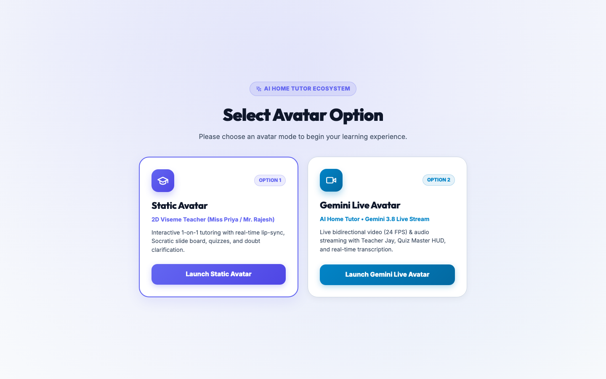
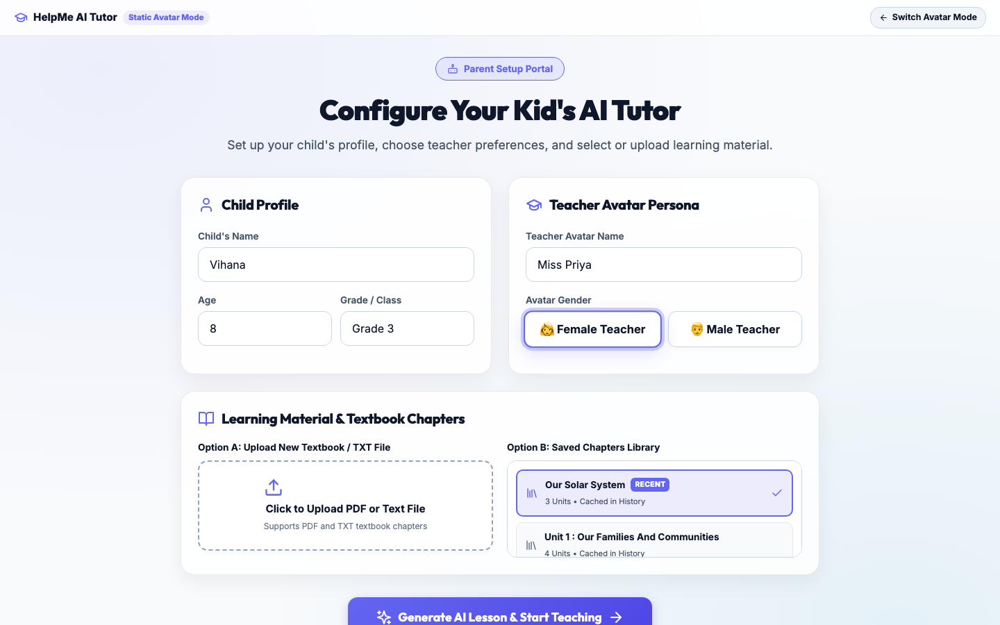
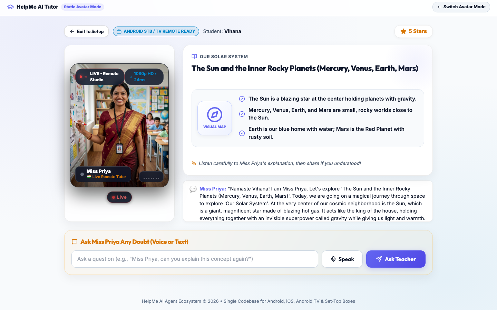
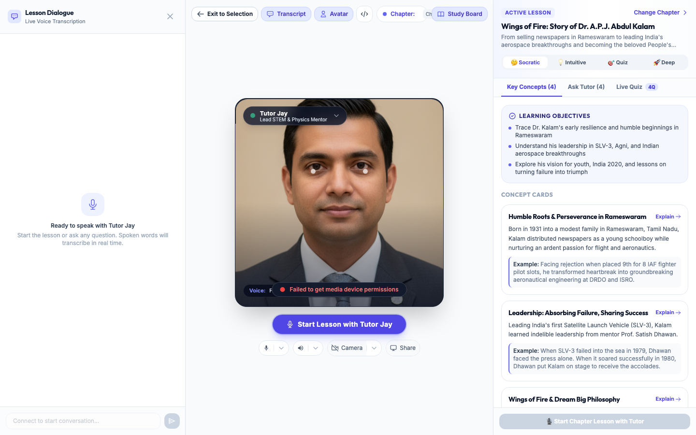
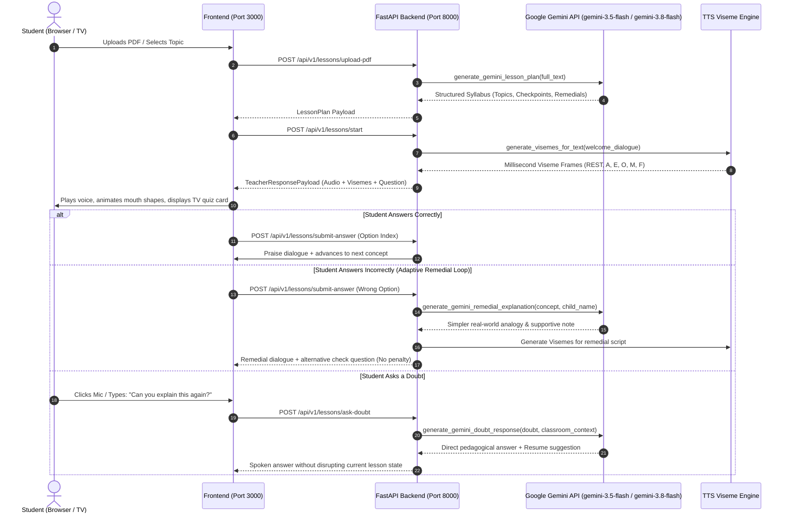
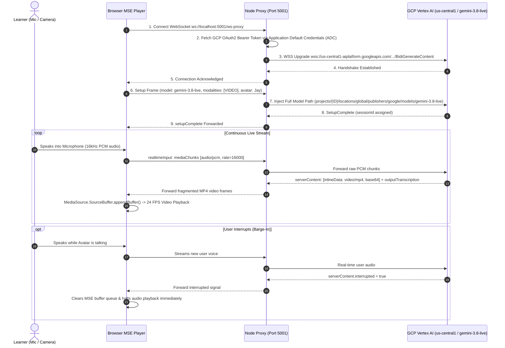

# HelpMe: Multi-Platform AI Agent Ecosystem 🚀
### Intelligent Socratic Tutoring & Real-Time Bidirectional Gemini Avatar Streaming

**HelpMe** is a cross-platform AI Agent ecosystem built for **Web, iOS, Android, Android TV, and Android Set-Top Boxes (STBs)**. It features dynamic agent metamorphosis, transitioning seamlessly between an **Interactive AI Socratic Tutor** for students and an **AI Receptionist** for front-desk intake, backed by two distinct avatar engines: **Static Avatar Mode** (lightweight Socratic lip-sync) and **Live Avatar Mode** (24 FPS photorealistic generative video streaming from Google Cloud Vertex AI).

---

## 📑 Table of Contents
1. [Core Features](#-core-features)
2. [Application Visual Tour (Screenshots)](#-application-visual-tour)
3. [Dual Avatar Architecture: Static vs. Live](#-dual-avatar-architecture-static-vs-live)
4. [Module & Repository Structure](#-module--repository-structure)
5. [API & Architecture Deep Dive](#-api--architecture-deep-dive)
   * [A. Static Avatar Mode Flow (Socratic Loop)](#a-static-avatar-mode-flow-socratic-loop)
   * [B. Live Avatar Mode Flow (GCP Vertex AI Streaming)](#b-live-avatar-mode-flow-gcp-vertex-ai-streaming)
6. [Quick Setup & Run Guide](#-quick-setup--run-guide)
   * [One-Command Launch (All Services)](#1-all-in-one-startup-script-recommended)
   * [Manual / Individual Launches](#2-individual-service-setup--manual-launch)
7. [Environment Configuration](#-environment-configuration)
8. [Service & Ports Dashboard](#-service--ports-dashboard)

---

## ✨ Core Features

* 🎓 **Dual AI Teacher Experiences**:
  * **Static Avatar Mode (*Miss Priya* & *Professor Sharma*)**: High-resolution photorealistic avatar studio with millisecond-accurate viseme lip-sync, dynamic audio spectrum analyzer, and Indian neural voice accents.
  * **Live Avatar Mode (*Tutor Jay*)**: Full-duplex bidirectional streaming video avatar generated at 24 FPS by Google Cloud Vertex AI with conversational interruption (barge-in) support.
* 📚 **Deep PDF / TXT Ingestion**: Parses entire textbook chapters without truncation, building comprehensive multi-unit syllabi with checkpoints and Socratic guidance.
* 🎙️ **Conversational Doubt Clarification**: Kids can click the Mic button or speak aloud at any point (*"Miss Priya, can you explain this concept again?"*) to receive context-aware verbal answers without losing lesson progress.
* 🔄 **Adaptive Remedial Loop**: If a student answers incorrectly, the teacher re-explains using simpler real-world analogies and presents fresh follow-up check questions until 100% mastery is achieved.
* 📺 **Android STB & TV Remote Control Ready**: Spatial D-Pad navigation (`UP`, `DOWN`, `LEFT`, `RIGHT`, `ENTER/OK`) with glowing focus rings on quiz cards.
* 🏢 **AI Receptionist Metamorphosis**: Seamless persona transformation into a front-desk receptionist for corporate check-ins or clinic appointments.
* 📊 **Parent Analytics Digest**: Comprehension score dial, mastered concepts breakdown, and teacher notes audit log.

---

## 📸 Application Visual Tour

### 1. Launch Mode Selection Screen (First Selection)
The platform landing screen presents the student or parent with the dual avatar selection:



---

### 2. Option 1 Home — Static Avatar Setup & Socratic Classroom
* **Parent Setup Portal (Option 1 Home)**: Configure student name, grade level, choose your teacher persona (*Miss Priya* or *Professor Sharma*), and upload custom PDF textbooks or pick from saved curriculum chapters.
* **Live Socratic Classroom**: Live interactive remote studio call with real-time lip-sync, animated topic visual slides, and instant verbal doubt clarification.

| 🛠️ Option 1 Home: Parent Setup & Avatar Preference | 🎓 Live Socratic Classroom Session |
| :---: | :---: |
|  |  |

---

### 3. Option 2 Home — Gemini Live Avatar Studio
Real-time bidirectional 24 FPS video and audio streaming classroom with **Tutor Jay** powered by **Google Cloud Vertex AI `gemini-3.8-live`**, featuring live speech transcription, real-time barge-in interruption, and interactive Socratic quiz overlays:



---

## 🎭 Dual Avatar Architecture: Static vs. Live

HelpMe supports two complementary avatar modes tailored for different hardware capabilities and bandwidth requirements:

| Dimension | 🖼️ Static Avatar Mode | ⚡ Live Avatar Mode |
| :--- | :--- | :--- |
| **Primary Avatar** | *Miss Priya* (Female) / *Prof. Sharma* (Male) | *Tutor Jay* |
| **Target Device** | Android TV, STBs, Low-Bandwidth Mobile | High-Speed Desktop, Modern Tablets |
| **Generative Model** | Google Gemini `gemini-3.5-flash-lite` & `gemini-3.8-flash` | Google Cloud Vertex AI `gemini-3.8-live` |
| **API Provider** | Google AI Studio / Google GenAI SDK (`@google/genai`) | Google Cloud Vertex AI Studio (`LlmBidiService`) |
| **Connection Protocol** | HTTP REST + WebSocket (`ws://localhost:8000`) | Bidirectional Secure WebSocket (`wss://`) |
| **Local Proxy Required** | No (direct FastAPI backend) | Yes (Node.js Proxy on Port `5001`) |
| **Video Output** | WebRTC-styled UI with Viseme lip-sync animation | Continuous 24 FPS fragmented MP4 (`video/mp4`) chunks |
| **Browser Video Player** | HTML5 Canvas / Image renderer + Web Audio API | MediaSource Extensions (MSE) `<video>` buffer |
| **Audio Input / Output** | Web Speech API / 16kHz PCM audio | 16kHz PCM raw microphone audio / 24kHz synthesized audio |
| **Interruption (Barge-In)** | Push-to-Talk & speech-end triggers | Real-time server-side `interrupted` signal |

---

## 🏗️ Module & Repository Structure

```
AIAgent/
├── backend/                                # Python FastAPI Backend (Port 8000)
│   ├── app/
│   │   ├── api/routes.py                   # REST endpoints (PDF upload, sessions, doubts)
│   │   ├── models/schemas.py               # Pydantic data schemas
│   │   ├── services/
│   │   │   ├── pdf_service.py              # Textbook parsing & syllabus extraction
│   │   │   ├── llm_service.py              # Google Gemini API integration (lesson plan, remedial, doubts)
│   │   │   ├── tts_viseme_service.py       # Viseme lip-sync frame generator
│   │   │   ├── teacher_service.py          # Socratic state machine & remedial loop
│   │   │   └── gemini_live_avatar_service.py # Gemini live avatar WebSocket gateway
│   │   └── main.py                         # FastAPI application entry point
│   ├── requirements.txt                    # Python dependencies
│   └── .env                                # Gemini API key & GCP project config
│
├── frontend/                               # Unified React Web & TV App (Port 3000)
│   ├── public/                             # High-res teacher photos (Miss Priya, Prof. Sharma)
│   ├── src/
│   │   ├── components/                     # Static Avatar Socratic Classroom components
│   │   │   ├── AvatarCanvas.jsx            # Studio frame, spectrum visualizer, lip-sync
│   │   │   ├── StudentClassroom.jsx        # Socratic classroom & D-Pad TV navigation
│   │   │   ├── ParentSetup.jsx             # Child configuration & textbook uploader
│   │   │   └── ParentReportView.jsx        # Parent analytics digest
│   │   ├── live-avatar/                    # Integrated Gemini Live Avatar Module
│   │   │   ├── LiveAvatarApp.tsx           # Full-duplex live avatar classroom entry
│   │   │   ├── components/                 # AvatarDisplay (MSE video), QuizOverlay, StudyBoard
│   │   │   ├── hooks/useLiveSession.ts     # Real-time WebSocket connection hook
│   │   │   └── vertex-ai-proxy-interceptor.js # WebSocket & API request router to proxy
│   │   ├── App.jsx                         # Main launcher & Mode Selector
│   │   └── vite.config.js                  # Port 3000 config + proxies to port 5001
│   └── package.json
│
├── Gemini AI avatar module/                # Dedicated Vertex AI Proxy & Standalone Client
│   ├── backend/                            # Node.js Express Proxy (Port 5001)
│   │   ├── server.js                       # Handles GCP OAuth2 ADC tokens & WSS upgrade
│   │   ├── package.json
│   │   └── .env.local                      # GCP project ID, location, port (5001)
│   └── frontend/                           # Standalone Live Avatar Test App (Port 5173)
│       └── vite.config.ts
│
├── logs/                                   # Real-time service execution logs
├── start.sh                                # All-in-one launcher script
├── stop.sh                                 # One-click service terminator script
└── README.md
```

---

## 🔍 API & Architecture Deep Dive

### A. Static Avatar Mode Flow (Socratic Loop)

In Static Avatar Mode, the learner interacts with an interactive Socratic teacher (*Miss Priya* or *Prof. Sharma*) with mouth lip-sync and audio visualizers.



#### APIs Used in Static Mode:
1. **Google Gemini API (`gemini-3.5-flash-lite`, `gemini-3.8-flash`)**:
   * Endpoint: `https://generativelanguage.googleapis.com/v1beta/models/{model}:generateContent`
   * Method: Structured JSON extraction with system instructions for pediatric teaching.
   * Authentication: `GEMINI_API_KEY` from Google AI Studio.
2. **Text-to-Viseme Engine (`TTSVisemeService`)**:
   * Maps phonetic characters to standard mouth opening & widening parameters:
     * `A`: Broad open (mouth open 0.8)
     * `O`: Rounded open (mouth open 0.9, wide 0.2)
     * `E`: Wide grin (mouth open 0.5, wide 0.9)
     * `M`: Bilabial closed (mouth open 0.05, wide 0.3)
     * `F`: Labiodental (mouth open 0.2, wide 0.5)

---

### B. Live Avatar Mode Flow (GCP Vertex AI Streaming)

In Live Avatar Mode, the user engages in a continuous full-duplex conversational video stream with *Tutor Jay*.



#### APIs Used in Live Mode:
1. **Google Cloud Vertex AI Studio (`gemini-3.8-live`)**:
   * **RPC Service**: `google.cloud.aiplatform.v1beta1.LlmBidiService`
   * **RPC Method**: `BidiGenerateContent`
   * **WSS Endpoint**: `wss://us-central1-aiplatform.googleapis.com//ws/google.cloud.aiplatform.v1beta1.LlmBidiService/BidiGenerateContent`
   * **Model Path**: `projects/{GCP_PROJECT_ID}/locations/global/publishers/google/models/gemini-3.8-live`
   * **Authentication**: GCP Application Default Credentials (`gcloud auth application-default login`) with OAuth2 Bearer token attached to the WebSocket upgrade request.
2. **Local Node.js WebSocket Proxy ([`Gemini AI avatar module/backend/server.js`](file:///Users/prabhakaranpanjalingam/Documents/AIBuilderCup/V2/AIAgent/Gemini%20AI%20avatar%20module/backend/server.js))**:
   * Proxies browser WebSocket traffic from `/ws-proxy` to GCP's secure endpoint.
   * Manages OAuth2 token refresh and CORS/trust proxy headers.
3. **MediaSource Extensions (MSE)**:
   * Decodes streamed fragmented MP4 chunks (`video/mp4; codecs="avc1.42E01E, mp4a.40.2"`) in real time with zero file lag.

---

## 🚀 Quick Setup & Run Guide

### Prerequisites
* **Node.js**: v18+ (verified on v24+)
* **Python**: v3.9+ (verified on v3.13+)
* **Google Cloud SDK (`gcloud`)**: Required for Live Avatar Mode
  ```bash
  gcloud auth application-default login
  gcloud config set project YOUR_GCP_PROJECT_ID
  ```

---

### 1. All-in-One Startup Script (Recommended)

Launch all backends and frontends simultaneously with a single command:

```bash
# Start all 4 services (FastAPI, Node Proxy, HelpMe Web, Avatar Client)
./start.sh
```

To run in the background (detached):
```bash
./start.sh --daemon
```

To stop all services cleanly anytime:
```bash
./stop.sh
```

---

### 2. Individual Service Setup & Manual Launch

If you prefer starting services in separate terminal tabs:

#### A. Launch HelpMe FastAPI Python Backend (Port 8000)
```bash
cd backend
python3 -m pip install -r requirements.txt
python3 -m uvicorn app.main:app --host 0.0.0.0 --port 8000 --reload
```
* **Interactive Docs**: `http://localhost:8000/docs`

#### B. Launch Gemini Live Avatar Node.js Proxy (Port 5001)
```bash
cd "Gemini AI avatar module/backend"
npm install
node --env-file=.env.local server.js
```
* **Proxy Status**: Active on `http://localhost:5001` (proxies `/api-proxy` and `/ws-proxy`)

#### C. Launch HelpMe Unified React Frontend (Port 3000)
```bash
cd frontend
npm install
npm run dev
```
* **Main App URL**: `http://localhost:3000/`

#### D. Launch Gemini Live Avatar Standalone Frontend (Port 5173)
```bash
cd "Gemini AI avatar module/frontend"
npm install
npm run dev
```
* **Standalone Client**: `http://localhost:5173/`

---

## ⚙️ Environment Configuration

### 1. FastAPI Backend ([`backend/.env`](file:///Users/prabhakaranpanjalingam/Documents/AIBuilderCup/V2/AIAgent/backend/.env))
```env
# Google Gemini API Key for Socratic Tutor & Receptionist Agent
GEMINI_API_KEY=your_gemini_api_key_here

# GCP Project Configuration
GCP_PROJECT_ID=your_gcp_project_id_here
GCP_LOCATION=asia-south1
```

### 2. Node.js Live Avatar Proxy ([`Gemini AI avatar module/backend/.env.local`](file:///Users/prabhakaranpanjalingam/Documents/AIBuilderCup/V2/AIAgent/Gemini%20AI%20avatar%20module/backend/.env.local))
```env
API_BACKEND_HOST=127.0.0.1
API_BACKEND_PORT=5001
API_PAYLOAD_MAX_SIZE=7mb

# GCP Vertex AI Live Avatar Cluster
GOOGLE_CLOUD_LOCATION=global
GOOGLE_CLOUD_PROJECT=your_gcp_project_id_here
PROXY_HEADER=your_custom_proxy_header_secret
```

---

## 📊 Service & Ports Dashboard

| Service | Technology | Port | URL / Health Endpoint | Purpose |
| :--- | :--- | :--- | :--- | :--- |
| **HelpMe Platform** | React + Vite | `3000` | [http://localhost:3000](http://localhost:3000) | Main unified web application (mode switcher, classroom, reports) |
| **HelpMe Backend** | FastAPI (Python) | `8000` | [http://localhost:8000/docs](http://localhost:8000/docs) | Socratic teaching state machine, PDF parser, Gemini doubt engine |
| **Live Avatar Proxy** | Express (Node.js) | `5001` | [http://localhost:5001](http://localhost:5001) | GCP Vertex AI authentication & bidirectional WebSocket gateway |
| **Avatar Test App** | React + Vite | `5173` | [http://localhost:5173](http://localhost:5173) | Standalone Vertex AI avatar testing interface |

---

## 📤 Pushing to Git Repository

```bash
# Stage changes
git add .

# Create commit
git commit -m "Update ecosystem README: Static vs Live Avatar architecture, flows, APIs, and unified startup script"

# Push to your branch
git push origin model_3.8_live_integration
```
